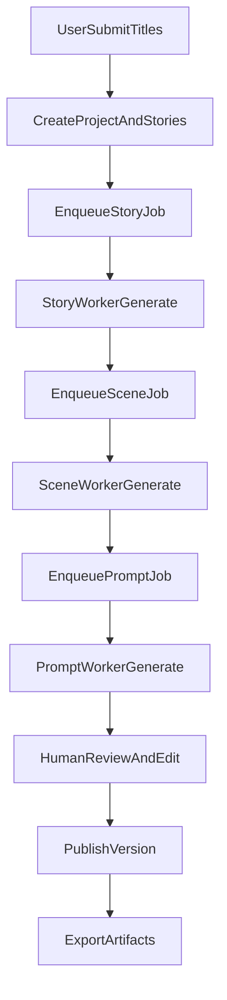
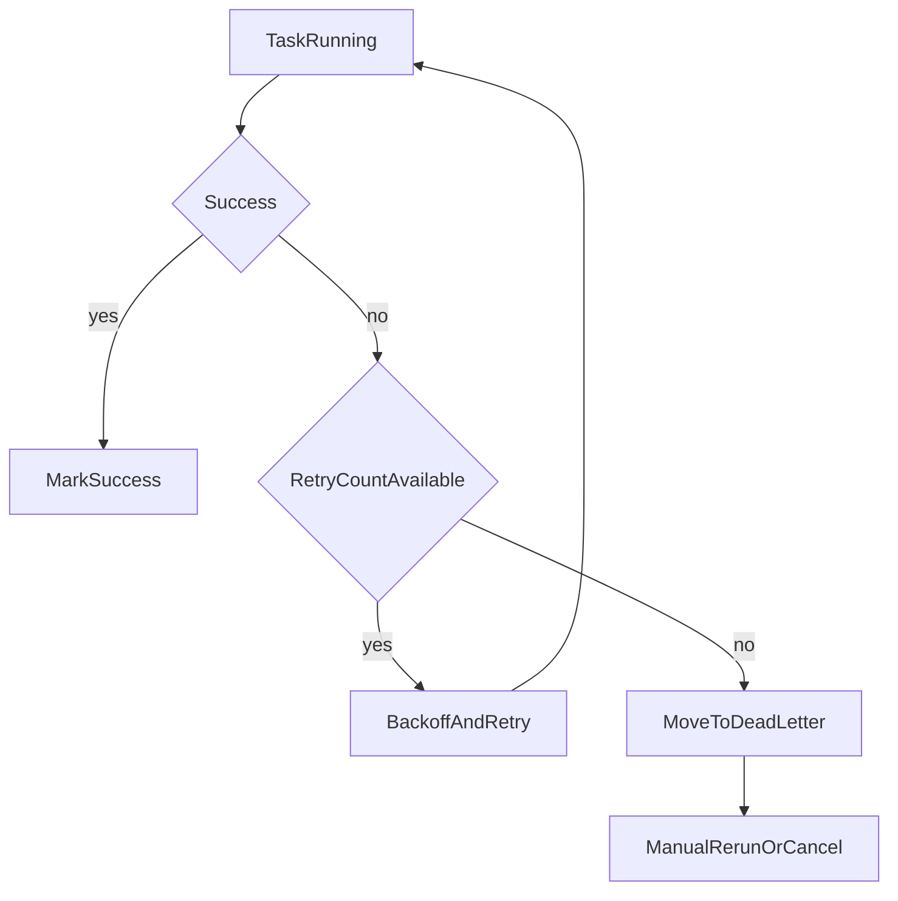

# 短视频AI系统领域模型与业务流程

## 1. 领域对象
- Workspace：工作区，隔离用户配置、项目、资产与账单。
- Project：一次内容生产容器，包含多个故事任务。
- Story：故事正文实体，支持多版本。
- Scene：分镜实体，隶属于故事版本。
- ScenePrompt：镜头出图提示词，隶属于分镜。
- GenerationTask：异步任务实体，覆盖故事/分镜/提示词三个阶段。
- ProviderConfig：模型连接配置（文本或图像）。
- PromptTemplate：提示词模板（支持版本与发布状态）。

## 2. 领域关系
- Workspace 1:N Project
- Project 1:N Story
- Story 1:N Scene
- Scene 1:N ScenePrompt
- Workspace 1:N ProviderConfig
- Workspace 1:N PromptTemplate
- Story/Scene/ScenePrompt 均与 GenerationTask 关联

## 3. 业务流程一：单标题生成
1. 用户在项目中提交故事标题与参数。
2. 系统创建Story草稿与Story生成任务。
3. Worker调用文本模型生成故事正文与摘要。
4. 系统自动触发分镜生成任务。
5. Worker生成镜头列表，保存Scene集合。
6. 系统自动触发提示词生成任务。
7. Worker为每个镜头生成ScenePrompt。
8. 用户人工修订后导出。

## 4. 业务流程二：批量标题生成
1. 用户一次提交多个标题（建议上限100）。
2. 系统按标题拆分为多个子任务并入队。
3. 任务并发执行，支持按工作区限流。
4. 任务结果逐条回写，部分失败可单独重跑。

## 5. 业务流程三：失败重试与补偿
- 失败类型：模型超时、限流、响应格式不合法、敏感内容拦截。
- 自动重试：指数退避（30s/2m/10m），最多3-5次。
- 死信处理：超过最大重试进入DeadLetter队列，人工触发重跑。
- 补偿规则：分镜失败不影响已生成故事，提示词失败不回滚分镜。

## 6. 业务流程四：人工修订与版本化
- 每次AI生成创建新版本，不覆盖旧版本。
- 用户编辑后可发布为“当前使用版本”。
- 支持版本对比、回滚、备注与责任人记录。

## 7. 状态机定义
### 7.1 任务状态
- PENDING：待执行
- RUNNING：执行中
- SUCCESS：成功
- FAILED：失败
- RETRYING：重试中
- DEAD_LETTER：死信

### 7.2 故事状态
- DRAFT：草稿
- GENERATED：已生成
- REVIEWING：人工审核中
- APPROVED：通过
- REJECTED：驳回

### 7.3 分镜状态
- INIT：初始
- GENERATED：已生成
- EDITED：已编辑
- LOCKED：已锁定（用于导出）

## 8. 关键业务规则
- 同一工作区内，任务执行受并发额度限制。
- 故事删除为软删除，保留审计与账单关联。
- 模板发布后不可直接覆盖，必须新增版本。
- 密钥仅管理员可见明文录入，读取时仅返回掩码。

## 9. 可观测字段（建议统一）
- traceId：请求链路追踪ID
- taskId：任务唯一ID
- providerRequestId：外部模型请求ID
- workspaceId / projectId / storyId：业务主键
- retryCount / elapsedMs / tokenUsage：运行指标

## 10. 端到端流程图

## 11. 异常流程图

