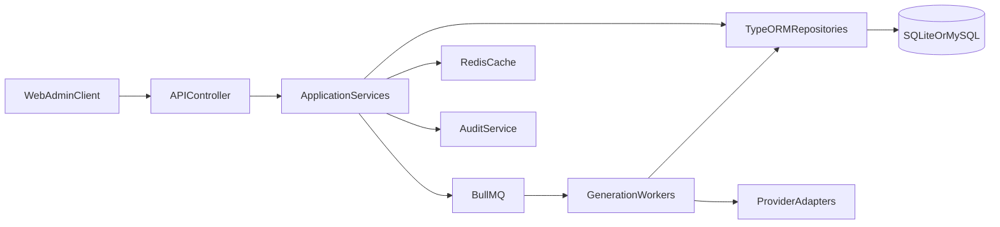
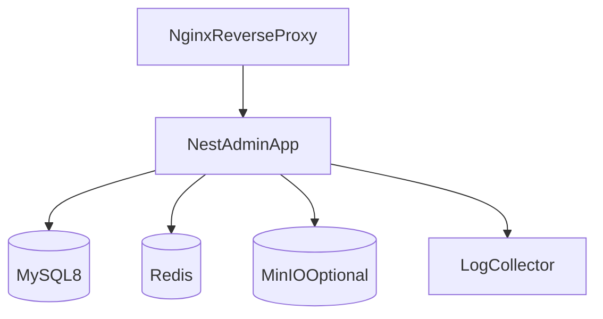

# 短视频AI系统架构设计（Nest-admin）

## 1. 架构目标
- 复用 nest-admin 在权限、菜单、日志、配置方面的成熟能力。
- 通过模块化和适配器模式支持多模型、多阶段内容生成。
- 保证开发环境轻量（SQLite）与生产环境稳定（MySQL）。

## 2. 分层架构
- Interface层：Controller、DTO、Validation、AuthGuard。
- Application层：UseCase/Service，编排业务流程与事务边界。
- Domain层：实体、聚合、领域服务、状态机规则。
- Infrastructure层：ORM、队列、缓存、对象存储、Provider适配器。

## 3. 模块划分（建议）
- `auth`：登录、JWT、RBAC、菜单权限。
- `workspace`：工作区、成员、租户策略。
- `provider`：模型提供方配置与探活。
- `template`：提示词模板与版本发布。
- `project`：项目生命周期管理。
- `story`：故事生成、编辑、版本。
- `storyboard`：分镜生成、镜头管理。
- `prompt`：出图提示词生成与参数映射。
- `job`：任务调度、状态回写、死信处理。
- `billing`：token统计、费用核算、预算告警。
- `audit`：审计日志与安全事件。

## 4. 混合租户策略（Hybrid）
### 4.1 默认模式：单库多租户
- 在核心表统一带 `workspace_id`。
- 查询统一通过TenantContext注入隔离条件。
- 管理员可跨工作区查看，但需审计记录。

### 4.2 企业模式：独立数据库
- 通过 `TenantRouter` 按workspace路由到独立连接。
- 共享主数据（如系统字典）保留在主库。
- 迁移脚本支持“按租户批量升级”。

## 5. Provider适配器架构
- 定义统一接口：
  - `generateText(req): TextGenResult`
  - `generateImagePrompt(req): PromptGenResult`
  - `healthCheck(): ProviderHealth`
- 每个供应商实现独立Adapter，统一错误码映射。
- 支持按工作区设置主/备Provider与失败切换。

## 6. 任务编排架构
- 队列：BullMQ + Redis。
- 队列分层：
  - `story_generate`
  - `scene_generate`
  - `prompt_generate`
- Job Payload包含：业务ID、workspaceId、模板版本、幂等键、traceId。
- Worker职责：
  - 参数组装
  - 模型调用
  - 结构校验
  - 状态回写
  - 失败重试决策

## 7. 数据流设计

## 8. 部署拓扑（单机Compose）

## 9. 配置体系
- 环境分层：`.env.development`、`.env.production`。
- 密钥管理：应用启动时解密，不落盘明文。
- 关键配置项：
  - `DB_TYPE`（sqlite/mysql）
  - `DB_URL` 或分项连接参数
  - `REDIS_URL`
  - `JWT_SECRET`
  - `ENCRYPTION_KEY`
  - `OBJECT_STORAGE_*`

## 10. 可扩展性设计
- 功能扩展：新增“配音/TTS”“视频合成”作为独立模块并接入任务总线。
- 模型扩展：新增Provider仅需实现Adapter接口并注册。
- 数据扩展：版本字段与扩展JSON字段并存，避免频繁大迁移。

## 11. 可靠性与性能策略
- 接口层限流：按workspace与用户双维度限制。
- 任务层并发：可按队列与租户动态配置并发度。
- 熔断与降级：外部Provider故障时自动切备或暂停下游任务。
- 幂等策略：`idempotency_key` 防重复提交。

## 12. 技术风险与规避
- 外部模型返回结构不稳定：使用JSON Schema校验与纠正器。
- 任务高峰堆积：分级队列、优先级与预算阈值暂停策略。
- 跨租户风险：全局查询守卫 + 审计巡检任务。
