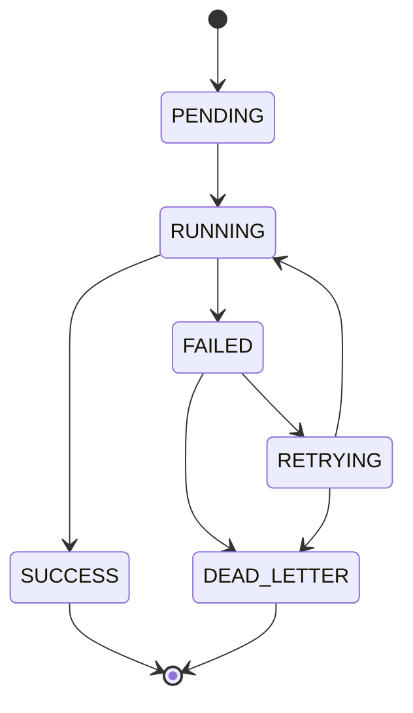

# 短视频AI系统异步任务与状态机设计

## 1. 目标
- 将耗时AI流程从同步请求中解耦，提升稳定性和吞吐。
- 提供可追踪、可重试、可补偿、可审计的任务运行机制。

## 2. 队列划分
- `queue_story_generate`
- `queue_scene_generate`
- `queue_prompt_generate`
- `queue_dead_letter`

每个队列可独立设置并发与重试，避免互相抢占。

## 3. 作业载荷（Job Payload）规范
```json
{
  "taskId": 12345,
  "workspaceId": 1001,
  "bizType": "story",
  "bizId": 99001,
  "templateVersionId": 3002,
  "providerConfigId": 5008,
  "idempotencyKey": "story:99001:v2",
  "traceId": "7d3f..."
}
```

## 4. 状态机定义


## 5. 执行流程
1. API创建任务并入队（状态PENDING）。
2. Worker领取任务并CAS更新为RUNNING。
3. 调用Provider适配器执行。
4. 结果通过Schema校验。
5. 成功则写入结果并置SUCCESS；失败按策略进入FAILED/RETRYING/DEAD_LETTER。

## 6. 重试策略
- 默认最大重试：3次（可按工作区覆盖）。
- 退避策略：指数退避 + 随机抖动。
- 可重试错误：
  - 网络超时
  - 429限流
  - 5xx上游错误
- 不可重试错误：
  - 参数非法
  - 模板变量缺失
  - 内容审核拒绝（可改稿后重提）

## 7. 幂等与去重
- 使用 `idempotency_key` 去重，防止重复消费与重复提交。
- Worker在写入结果前二次检查任务最终态，防并发重入。

## 8. 超时与中断
- 每类任务有独立超时：
  - story：120s
  - scene：90s
  - prompt：60s
- 超时统一映射错误码 `4002`，进入可重试通道。

## 9. 死信与人工补偿
- 达到最大重试后迁入死信队列，记录最终错误快照。
- 管理端支持：
  - 手动重跑（可更换模板或provider）
  - 标记忽略
  - 导出失败报告

## 10. 优先级与公平调度
- 优先级：高（单条）> 中（批量小）> 低（批量大）。
- 公平策略：按workspace设置并发上限，防止单租户独占资源。

## 11. 监控指标
- 队列长度、消费速率、失败率、重试率、死信率。
- 平均处理时长与P95时长（按任务类型）。
- 上游Provider成功率与超时率。

## 12. 告警规则（初版）
- 5分钟失败率 > 20% 告警。
- 死信队列长度 > 50 告警。
- 某provider连续10次超时触发降级告警。
