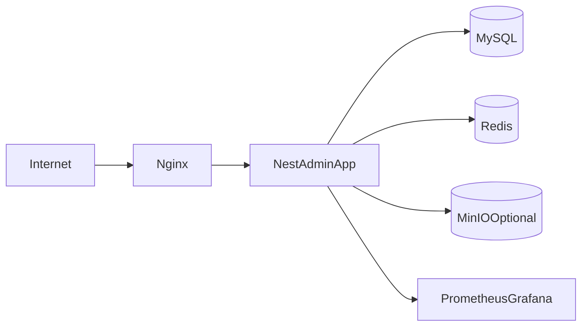

# 短视频AI系统部署与运维设计（单机Compose优先）

## 1. 目标
- 快速上线可用生产环境，支持后续平滑扩展到集群化部署。
- 保证核心服务高可观测、可备份、可恢复。

## 2. 生产组件
- `nginx`：反向代理、TLS终止、静态资源入口。
- `app`：Nest-admin主服务（可多副本，单机初期1副本）。
- `mysql`：主业务数据库。
- `redis`：队列与缓存。
- `minio`（可选）：对象存储（图片/导出文件）。
- `prometheus + grafana`（建议）：指标采集与可视化。

## 3. Docker Compose建议拓扑

## 4. 环境变量与密钥
- 核心变量：
  - `NODE_ENV=production`
  - `PORT=3000`
  - `DB_TYPE=mysql`
  - `DB_HOST/DB_PORT/DB_USER/DB_PASS/DB_NAME`
  - `REDIS_HOST/REDIS_PORT`
  - `JWT_SECRET`
  - `ENCRYPTION_KEY`
- 密钥注入建议：
  - `.env` 仅本机可读
  - CI/CD 用Secret Manager注入

## 5. 数据备份与恢复
- MySQL：
  - 每日全量备份（凌晨低峰）
  - 每小时binlog增量备份
- Redis：
  - 开启AOF，按需保留RDB快照
- MinIO：
  - 生命周期策略 + 异地备份（可选）

恢复演练：
- 每月至少一次恢复演练，验证RTO/RPO。

## 6. 日志与追踪
- 应用日志：结构化JSON，含 `traceId`、`workspaceId`、`taskId`。
- 访问日志：Nginx记录状态码、延迟、UA、来源IP。
- 错误日志：按错误码聚合，便于告警。

## 7. 监控告警
- 基础指标：
  - CPU、内存、磁盘、网络
  - MySQL连接数、慢查询
  - Redis内存与命中率
  - 队列长度、任务失败率
- 告警阈值示例：
  - 任务失败率 > 20%（5分钟）
  - MySQL磁盘使用 > 80%
  - Redis内存 > 75%

## 8. 发布与回滚
- 发布策略：蓝绿或滚动（单机可先停机短时发布）。
- 数据迁移：先执行migration再切流量。
- 回滚策略：
  - 应用版本回滚
  - 数据库迁移回退（需预演）
  - 队列暂停与恢复

## 9. 容量规划（初始）
- 日均标题量 5k 以内：
  - app 2C4G
  - mysql 4C8G SSD
  - redis 2C2G
- 达到10x增长时：
  - app水平扩容
  - mysql读写分离或托管RDS
  - 队列独立Worker进程组
